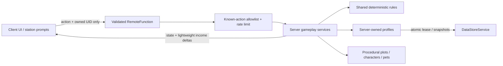

# Architecture and defaults

## Authority boundaries

Clients choose actions and display server results. They never supply a reward, price, stat, currency delta, save key or another player's identity. Shared definitions are visible for UI/odds; only the server runs awarding operations. One central Heartbeat accumulator awards income and sends lightweight HUD updates every two seconds. Inventory snapshots are sent on gameplay changes or explicit refresh; periodic social/save refresh is once a minute.

## Services

- **PlayerDataService**: profiles, separate Studio namespace, session leases, bounded retries, autosave/final release, schema protection, offline credit acquisition. An unsupported or failed load is never replaced with defaults.
- **CharacterService**: owned-instance validation, display capacity, independent three-unit battle teams.
- **EconomyService**: centralized bounded elapsed income and nonyielding validated upgrade transactions.
- **GachaService / Rules**: secure server Random, GUID instances, validated costs/capacity, staged atomic ten-pulls, exact next-draw odds.
- **WorldService / EnvironmentBuilder / WorldEffectsController**: static luxury city plus 12 decorated reusable plots, original form-specific models/portrait cards, limited-distance UI and welded pets; client-local effects use centralized distance and quality budgets.
- **ProgressionService**: finite guaranteed pet shop, seven one-time quests, rank milestones with no inventory resets. Ascension grants one display slot.
- **Combat / BattleService**: deterministic PvE rounds, speed priority, specials/guard/switch, automatic reserves, server-only one-time reward and 120-second inactivity timeout.
- **SocialBonusService**: verified in-server friends, capped contribution and a nonstacking ten-minute earned event. Only a successful first-win quest claim triggers the helper.
- **LeaderboardService**: five server-calculated player-list statistics. Global sorted boards are deferred.
- **ShopService**: PolicyService fail-closed query, ownership rechecks for optional passes, no paid luck or enabled developer products. Incomplete products remain off sale.

## Persistence behavior

Records use `{data = profile, session = {id, expiresAt}}` under `Player_<userId>`. `UpdateAsync` acquires a unique session lease and credits offline income in one committed write. Saves only replace data while the session ID still matches. Shutdown runs parallel release saves within a 25-second budget. Permanent service failures cannot guarantee the last unsaved minute; logs and real budget/load testing are required before release.

All state critical to progression is plain serializable data. Save payloads exclude live Player/Instance objects, active battles, friend caches, server events and display-only offline-award notices. Sanitization removes unknown fields, nonfinite values, unknown character references and over-cap inventories. Stable IDs must be migrated intentionally if content changes after publication. Trade and external inventory transfer are intentionally absent.

## Scope decisions

There is one free Coin banner and an expanded explorable procedural city. All 24 playable forms are original. Stable form IDs, base identities and independent mutations remain separate; version-one save metadata is enriched without resetting ownership. No real-person likeness is enabled; V3 retires generated face placeholders and reports unresolved photographs with neutral panels. Approved photos and custom models still require owner review/import. There are no paid random rewards, global limited units or paid assets. The ascension path remains earnable using the same characters for income and combat.

The initial delivery includes substantial progression and PvE beyond Phase 1, but it does not claim Phase 1 acceptance until Studio validates the full join/save/rejoin loop. Later phases still include consent-based PvP; durable global limited-stock reservation and grant recovery; developer-product fulfillment; daily tasks; XP/evolution; extra banners/areas; global boards; custom art; and live balancing/performance polish.
